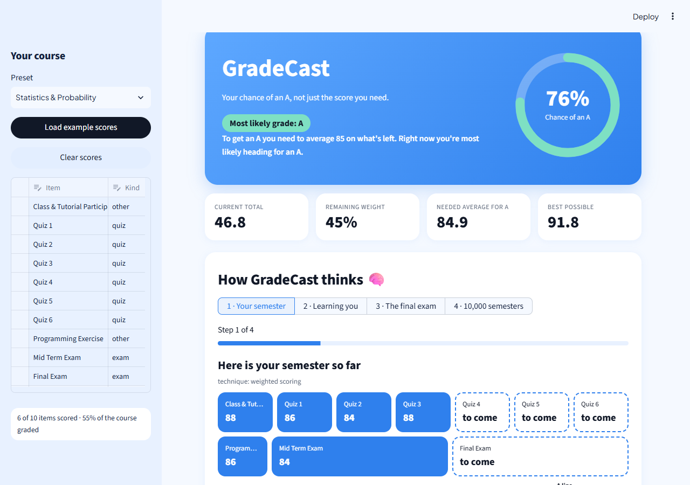

# GradeCast

Your chance of an A, not just the score you need: a Streamlit app that turns the scores you already have into a probability for every letter grade, with what-if scenarios.



## What it does

- Shows your current total, the weight still to come, the average you need for an A, and your best possible total.
- Gives the **probability of each letter grade** (A to E) for a course, using the Universitas Indonesia grading table.
- Predicts the final exam as a **range**, not a single number.
- Compares scenarios such as "Bomb the final", "Skip a quiz" and "Locked in", plus a custom scenario where you pin any remaining item to a score.
- Tells you the **safe zone**: the lowest Final Exam score that keeps you at least 50% likely to get an A.

No database, no login. Everything lives in your Streamlit session.

## How it works

1. **Deterministic math.** Current total = sum of `score x weight / 100` for the items you have taken. The needed average is the points still missing for 85 divided by the weight remaining.
2. **Gradient boosting for the final exam.** The model learns how early-semester performance relates to the final grade. Instead of one prediction it is trained with *quantile regression* at the 10th, 50th and 90th percentiles, so it outputs a low, middle and high guess. A range is more honest than a single number because one exam score is never certain. The spread of that range becomes the exam's standard deviation (never below 4 points).
3. **Bayesian updating for quizzes and other items.** We start from a typical student (mean 75, spread 12) and let each of your own scores pull that belief toward you. With few scores the starting belief matters a lot; with many, your own scores dominate. A noise floor stops a couple of similar scores from looking like certainty.
4. **Monte Carlo simulation.** For every unfinished item we draw a random score from its predictor, add everything up, and repeat 10,000 times. The share of runs ending in each letter is its probability. 10,000 runs is enough that the percentages barely move between runs, yet it still finishes in well under a second.
5. **Scenarios.** A scenario fixes ("pins") some scores or shifts every random draw up or down, then re-runs the simulation so you can compare.

## Model results

Trained on the UCI Student Performance dataset (Portuguese subset: 649 students, 641 after removing students who dropped out before the final; 512 train / 129 test rows). Scores are on a 0-100 scale.

| Model set | MAE (model) | MAE (baseline) | Coverage of q10-q90 (ideal 0.80) |
|---|---|---|---|
| With midterm | 3.11 | 3.66 | 0.80 |
| Without midterm | 5.03 | 4.84 | 0.78 |

The baseline guesses the final equals the average of the scores known so far. With the midterm the model beats it, while before the midterm the simple baseline is about as good (slightly better), so early predictions rest mostly on the range rather than on a sharper point guess. The ranges themselves are well calibrated.

## Limitations

- **Dataset mismatch.** The exam model learned from Portuguese secondary-school students and is applied to Indonesian university courses. Grades G1, G2, G3 are mapped to coursework, midterm and final, which is an approximation.
- **Few scores mean wide uncertainty.** Early in the semester the result is mostly the starting belief.
- **No grade curves.** Raw weighted totals are used.
- **Weights are entered by you.** The app cannot check them against your syllabus beyond making sure they add up to 100.

## Run locally

```bash
python3.13 -m venv .venv
source .venv/bin/activate          # Windows: .venv\Scripts\activate
pip install -r requirements.txt
python scripts/train_model.py      # optional: the trained model is already in models/
streamlit run app.py
pytest -q
```

## Deploy

1. Push the repo to GitHub (the trained model in `models/` is committed).
2. Go to [share.streamlit.io](https://share.streamlit.io) and choose **New app**.
3. Select this repository, branch `main`, and main file `app.py`.
4. Under **Advanced settings**, choose Python 3.13.
5. Click **Deploy**.

## Roadmap

- Saved courses
- Study log and timer
- Post-exam reflections with AI summaries
- Effort-aware predictions

## Data credit

Cortez, P. & Silva, A. (2008). *Using data mining to predict secondary school student performance.* UCI Student Performance dataset, licensed CC BY 4.0.
